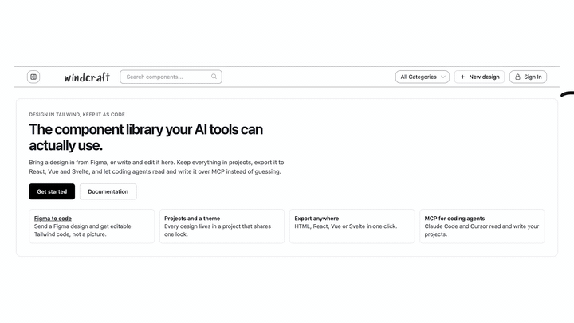
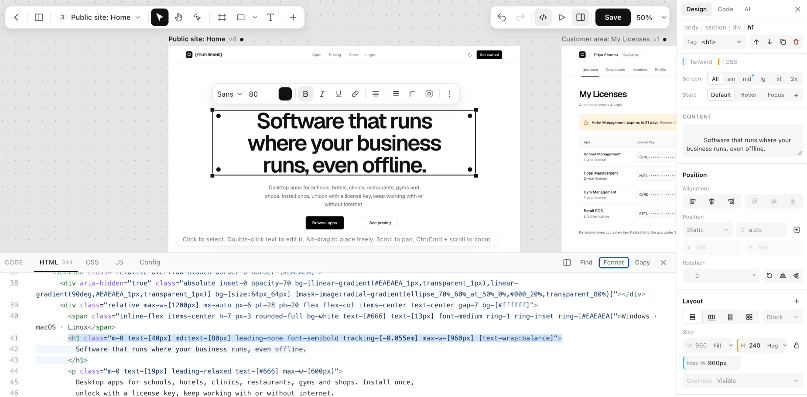
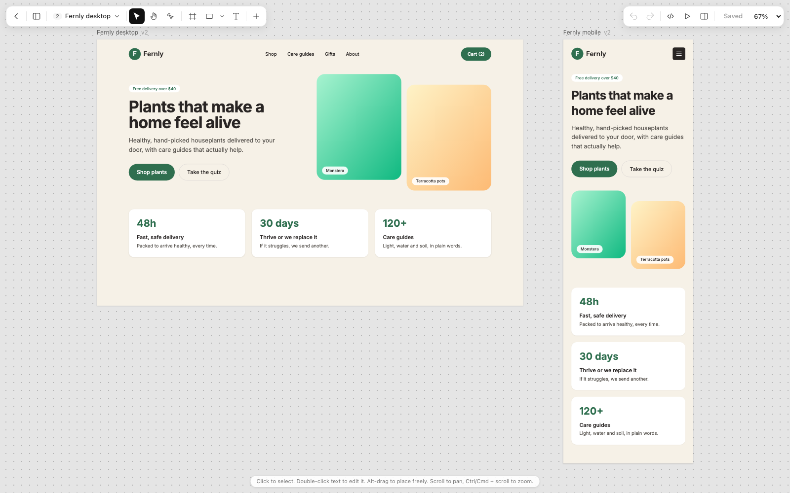

<div align="center">


### Design in Tailwind. Keep it as code.

**A visual design editor where every click writes real Tailwind HTML.**

[](https://www.npmjs.com/package/windcraft-editor)
[](https://nodejs.org)
[](https://tailwindcss.com)
[](#mcp-claude-claude-code-cursor)
[](https://www.figma.com/community/plugin/1697363010304569719)
[](LICENSE)

[**Try it live**](https://windcraft.swapniljadhav.com/) · [Watch the demo](docs/media/windcraft-demo.mp4) · [Get started](#get-started) · [Wiki](https://github.com/Tolaj/windcraft/wiki) · [npm](#npm-windcraft-editor) · [MCP](#mcp-claude-claude-code-cursor) · [Contribute](#contributing)

<br>

[](docs/media/windcraft-demo.mp4)

</div>

## Contents

[What it is](#what-it-is) · [Screenshots](#screenshots) · [What you can do](#what-you-can-do) · [Get started](#get-started) · [Documentation](#documentation) · [How it is built](#how-it-is-built) · [Status](#status) · [Roadmap](#roadmap) · [Contributing](#contributing) · [License](#license)

## What it is

Windcraft is an editor for web pages where the page is plain HTML with Tailwind classes, and every control reads and writes those classes. Make the padding bigger and `p-4` becomes `p-6`. Pick a colour and `bg-rose-500` changes. Edit the code and the design follows; edit the design and the code follows.

There is no export step and no Windcraft-only format. What you see in the editor is the HTML you ship, so you can paste it into a codebase or hand it to a coding agent as it is.

You can start from a blank page, from a Figma design (with a plugin that runs on your computer), or from a description (with Claude or a local model).

## Screenshots

<p align="center">
  
  <br><sub><b>Select a card</b> and the Properties panel shows its Tailwind values, while the code below highlights the exact element.</sub>
</p>

<table>
  <tr>
    <td valign="top">
      
      <br><b>Selection like Figma.</b> Click picks the top box, double-click goes one level in. The box you picked shows what it holds as dashed outlines.
    </td>
    <td valign="top">
      
      <br><b>Code and canvas in step.</b> Edit the HTML and the design follows. Edit the design and the code follows. Undo covers both.
    </td>
  </tr>
  <tr>
    <td valign="top">
      
      <br><b>Layers and pages.</b> Every element in a tree, every page on one infinite canvas.
    </td>
    <td valign="top">
      
      <br><b>Responsive by design.</b> Switch to Tablet or Mobile, or drag to any width. Edits land in the right breakpoint (<code>md:p-8</code>).
    </td>
  </tr>
</table>

## What you can do

**Edit visually**
- Select, move, resize, rotate, align, group, lock, hide, copy and paste, nudge with the arrow keys.
- Draw frames, rectangles, ovals, lines, arrows, text, images and buttons.
- **Drag to rearrange.** Inside its own box an element follows your pointer and the page shows the layout the drop will make. Drag it out and a copy follows the pointer while a blue outline shows where it will land; <kbd>Tab</kbd> tries the next placement and <kbd>Esc</kbd> cancels.
- **Edits are written for the device you are editing** (Mobile plain, Tablet `md:`, Desktop `lg:`), and a small bar lets you choose "this size and up", "only this size" or "all sizes".

**Work with the code**
- A Properties panel where every field is a Tailwind class, edited at its source. Breakpoints `sm` to `2xl` and states (`hover`, `focus`). `16px` becomes `p-4`; an off-scale value becomes `rounded-[10px]`.
- A live code panel: click an element and its code lights up; edit the HTML and the canvas follows. Paste HTML from anywhere.

**Bring things in**
- **Figma:** a free plugin turns a selection into HTML and Tailwind on your computer, with no LLM, no network and no picture fallback. Auto Layout becomes flex. See [packages/figma](packages/figma/README.md).
- **AI:** describe a page and **Anthropic Claude** or any **OpenAI-compatible local model** (Ollama, LM Studio, vLLM) drafts it with your project's tokens and best-matching components.

**Connect and share**
- **MCP server:** Claude, Claude Code and Cursor can read your design system and save pages into your projects. [Setup guide](https://github.com/Tolaj/windcraft/wiki/MCP-Server).
- **Projects:** one look per project (brand scale, gray, font, radius), a share link, a full-screen prototype view, export to HTML, React, Vue or Svelte, version history and a gallery.

## Get started

Pick your way in:

| I want to... | Use | Jump to |
|---|---|---|
| Try it now, nothing to install | The live editor | [Online](#online) |
| Put the editor in my own site or app | The npm package `windcraft-editor` | [npm](#npm-windcraft-editor) |
| Let Claude, Claude Code or Cursor build and save pages | The MCP server | [MCP](#mcp-claude-claude-code-cursor) |
| Turn a Figma design into HTML and Tailwind | The Figma plugin | [Figma plugin](#figma-plugin) |
| Run my own copy (accounts, projects, AI) | The full app | [Self-host](#self-host-the-full-app) |
| Hack on the editor itself | The demo, no database | [Run the editor locally](#run-the-editor-locally-no-database) |

### Online

Open **<https://windcraft.swapniljadhav.com/>**. Nothing to install.

### npm: `windcraft-editor`

```bash
npm install windcraft-editor
```

Serve `node_modules/windcraft-editor` as static files (for example `app.use("/windcraft", express.static("node_modules/windcraft-editor"))`) and import from it:

```js
import { startEditor } from "/windcraft/editor/index.js";
startEditor(document.getElementById("root"), { html: "<h1>Hello</h1>" });
```

No bundler or backend is needed. To try it without installing, save this as `index.html`, run `npx serve` next to it and open the address it prints:

```html
<div id="root"></div>
<script type="module">
  import { startEditor } from "https://unpkg.com/windcraft-editor/editor/index.js";
  startEditor(document.getElementById("root"), {
    html: '<h1 class="p-10 text-4xl font-bold">Hello</h1>',
  });
</script>
```

| Function | Use it when |
|---|---|
| `startEditor(root, options)` | The editor is the whole page. Designs are saved in the browser. |
| `mountEditor(root, options)` | You want to load and save on your own server (give it a host: a few functions). |
| `embedEditor(root, options)` | The editor lives in one box of a page. It runs in an iframe, so several can share a page. |

The [full guide](packages/editor/README.md) has the options, the host functions and `onChange`.

### MCP: Claude, Claude Code, Cursor

Windcraft runs an [MCP](https://modelcontextprotocol.io) server at your Windcraft address plus `/mcp`:

```
https://windcraft.swapniljadhav.com/mcp          (yours: https://your-windcraft-address/mcp)
```

| Client | How to connect |
|---|---|
| **Claude** (claude.ai) | Settings → Connectors → Add custom connector → paste the address → Connect → sign in to Windcraft → Allow. No token. |
| **Claude Code** | Create an access token on the Connect page (`/connect`), then: `claude mcp add --transport http tailwind-library <address> --header "Authorization: Bearer $TAILWIND_LIBRARY_TOKEN"` |
| **Cursor** and other clients | Add an HTTP server with the address and the header `Authorization: Bearer <token>`. The [MCP guide](https://github.com/Tolaj/windcraft/wiki/MCP-Server) has the JSON. |

Then just ask. Some things to say:

| You say | What happens |
|---|---|
| "Read my design guide, then build a settings page that matches." | The AI reads your tokens and conventions first. |
| "Search my library for a pricing table and use it." | It searches and reuses your components. |
| "Save this page to my Windcraft library." | The page is saved as a design in your project. |
| "Save these three screens as pages in a project called Acme website." | One project, one page per screen. |
| "Make the Contact button in my Pricing page rose-500. Change nothing else." | A small patch to the saved design; the rest of the code is untouched. |
| "Which project am I working on? Switch to Acme." | Reads or changes your active project. |

The Connect page has a **Run test** button that checks the connection and says what to fix. The full tool list is in the [MCP guide](https://github.com/Tolaj/windcraft/wiki/MCP-Server).

### Figma plugin

Install it from the [Figma Community](https://www.figma.com/community/plugin/1697363010304569719). It converts a selection to HTML and Tailwind on your computer: no LLM, no network, no picture fallback.

To build it from source:

```bash
npm run build -w @windcraft/figma
```

In **Figma desktop**: *Plugins → Development → Import plugin from manifest…* and choose `packages/figma/dist/manifest.json`. More in [packages/figma](packages/figma/README.md).

### Self-host the full app

Accounts, projects, the gallery, AI and MCP. You need Node.js 18+ and a MongoDB database (local or Atlas).

```bash
git clone https://github.com/Tolaj/windcraft.git
cd windcraft
npm install
cp .env.example .env     # then fill in the values below
npm run dev              # http://localhost:3000
```

| Variable | What it is | Needed |
|---|---|---|
| `MONGO_URI` | MongoDB connection string | Yes |
| `SESSION_SECRET` | Secret that signs session cookies | Yes |
| `PORT` | Server port (default `3000`) | No |
| `PUBLIC_URL` | Public HTTPS address of the server. Needed for Claude on the web to connect over MCP; leave empty for local work | For MCP on the web |
| `ANTHROPIC_API_KEY` | Server-side key for Claude (people can also add their own in Settings) | For AI |
| `LLM_URL` | Endpoint of a local OpenAI-compatible model | For a local model |
| `ADMIN_EMAILS` | Who can open the admin pages | No |
| `GMAIL_ID`, `EMAIL_*` | Gmail OAuth, used to send sign-in verification codes | For sign-up emails |

For production, `npm start`. A `vercel.json` is included for Vercel.

### Run the editor locally (no database)

```bash
git clone https://github.com/Tolaj/windcraft.git
cd windcraft
npm install
npm run demo
```

Open <http://localhost:4000/editor/demo/> (add `?theme` to see a project theme applied).

## Documentation

The **[Windcraft wiki](https://github.com/Tolaj/windcraft/wiki)** has the guides:

| Page | What is in it |
|---|---|
| [Getting Started](https://github.com/Tolaj/windcraft/wiki/Getting-Started) | Every way in, and your first five minutes |
| [Using the Editor](https://github.com/Tolaj/windcraft/wiki/Using-the-Editor) | Selecting, dragging, screen sizes, handles, the Properties panel |
| [Embedding the Editor (npm)](https://github.com/Tolaj/windcraft/wiki/Embedding-the-Editor-npm) | `startEditor`, `mountEditor`, `embedEditor` and their options |
| [MCP Server](https://github.com/Tolaj/windcraft/wiki/MCP-Server) | Connect Claude, Claude Code or Cursor, what to ask, the tool list |
| [Figma Plugin](https://github.com/Tolaj/windcraft/wiki/Figma-Plugin) | Install, what it converts, what it does not |
| [Self-Hosting](https://github.com/Tolaj/windcraft/wiki/Self-Hosting) | Run the full app, environment variables |
| [Architecture](https://github.com/Tolaj/windcraft/wiki/Architecture) | Packages, the sandboxed frame, how a drag works |
| [Contributing and Reviews](https://github.com/Tolaj/windcraft/wiki/Contributing-and-Reviews) | How to contribute and how pull requests are reviewed |
| [FAQ and Troubleshooting](https://github.com/Tolaj/windcraft/wiki/FAQ-and-Troubleshooting) | Common problems |
| [Roadmap and Status](https://github.com/Tolaj/windcraft/wiki/Roadmap-and-Status) | What is solid, what is new, where to help |

## How it is built

A monorepo of small packages around a Node app.

| Package | What it does |
|---|---|
| [`windcraft-editor`](packages/editor) | The visual editor (on npm): canvas, layers, Properties panel, code panel, pages. Host-agnostic. |
| [`@windcraft/core`](packages/core) | The Tailwind logic: class groups, property-to-class mapping, layout inference, board layout, themes. Pure functions with tests. Bundled into `windcraft-editor` when it is published. |
| [`@windcraft/figma`](packages/figma) | The Figma to Tailwind converter and plugin. Fixed rules, no LLM. |
| [`@windcraft/mcp`](packages/mcp) | The MCP protocol for Express, with nothing about what the tools do. |
| [`@windcraft/ai`](packages/ai) | Provider-neutral AI generation (Anthropic and OpenAI-compatible). |
| `src/` | The app: Express 5, Handlebars, MongoDB. Accounts, projects, the gallery, sharing, the MCP tools. |

**Stack:** Node.js · Express 5 · Handlebars · MongoDB (Mongoose) · Tailwind CSS · CodeMirror 6 · Anthropic SDK.

One thing worth knowing before you read `packages/editor/design/agent.js`: it runs inside the sandboxed canvas frame and cannot import anything, so the rest of the editor talks to it with messages. [CONTRIBUTING.md](CONTRIBUTING.md) has the repo map, and [docs/PROJECT.md](docs/PROJECT.md) describes how the editor's parts work.

```bash
npm test            # unit tests for core, editor, ai, mcp and the Figma converter
npm run typecheck   # tsc over the whole repo
```

## Status

Windcraft is under active development. Honest notes on where things stand:

- **Solid:** the Properties panel, the code panel, selection and layers, the Figma converter's basic rules, projects and sharing.
- **Newer:** dragging elements around (rearranging and device-scoped edits). It has been tried in Chrome only; Safari, Firefox and touch are untried ([#8](https://github.com/Tolaj/windcraft/issues/8)), and it has not been timed on very large pages ([#9](https://github.com/Tolaj/windcraft/issues/9)).
- **Known gaps:** see the [open bugs](https://github.com/Tolaj/windcraft/labels/bug) and the Roadmap below.

## Roadmap

- Figma converter: constraints, lists, image crop, and responsive output.
- Components and variants as first-class Windcraft components.
- A steadier drag in more browsers and on large pages (see [Contributing](#contributing)).

## Contributing

Windcraft is MIT licensed and open to everyone. You do not need to ask first.

**Where to start**

| If you like... | Try |
|---|---|
| Writing docs | [#7](https://github.com/Tolaj/windcraft/issues/7): update the README and document how dragging works |
| Testing, no code | [#8](https://github.com/Tolaj/windcraft/issues/8): try the drag in Safari, Firefox and on touch and report |
| Performance | [#9](https://github.com/Tolaj/windcraft/issues/9): time the drag on pages with hundreds of elements |
| Fixing a bug | [#10](https://github.com/Tolaj/windcraft/issues/10): a card dropped on a bigger card lands inside a small row; [#6](https://github.com/Tolaj/windcraft/issues/6): the W/H field shows a rounded size |
| Refactoring with tests | [#11](https://github.com/Tolaj/windcraft/issues/11): move the drop-target rules into `packages/core` |
| Something else | Browse [`good first issue`](https://github.com/Tolaj/windcraft/labels/good%20first%20issue) and [`help wanted`](https://github.com/Tolaj/windcraft/labels/help%20wanted) |

**How**
1. **Fork** the repo, `npm install`, and `npm run demo` to see your change.
2. **Branch** (`git switch -c fix/thing`) and make it. Keep the pull request small and about one thing.
3. **Check:** `npm test` and `npm run typecheck`. A bug fix in `packages/core` or the Figma converter should come with a test that fails without it.
4. **Open a pull request** into `main` and say what you changed and how you checked it.

A first-time pull request gets a reply and a decision with reasons, including when the answer is "not now". [CONTRIBUTING.md](CONTRIBUTING.md) and the wiki's [Contributing and Reviews](https://github.com/Tolaj/windcraft/wiki/Contributing-and-Reviews) have the setup, how reviews work and the project's principles (the output stays real HTML and Tailwind; the Figma converter uses fixed rules, no LLM).

**Questions, bugs, ideas:** [open an issue](https://github.com/Tolaj/windcraft/issues/new). Steps, what you expected, what happened and your browser; a screenshot or a short recording helps a lot.

## License

[MIT](LICENSE) © 2026 Swapnil Jadhav. Third-party code keeps its own licenses: [THIRD_PARTY_LICENSES.md](THIRD_PARTY_LICENSES.md).

<div align="center">
<br>
<sub>Built by <a href="https://github.com/Tolaj">Swapnil Jadhav</a>.</sub>
</div>
