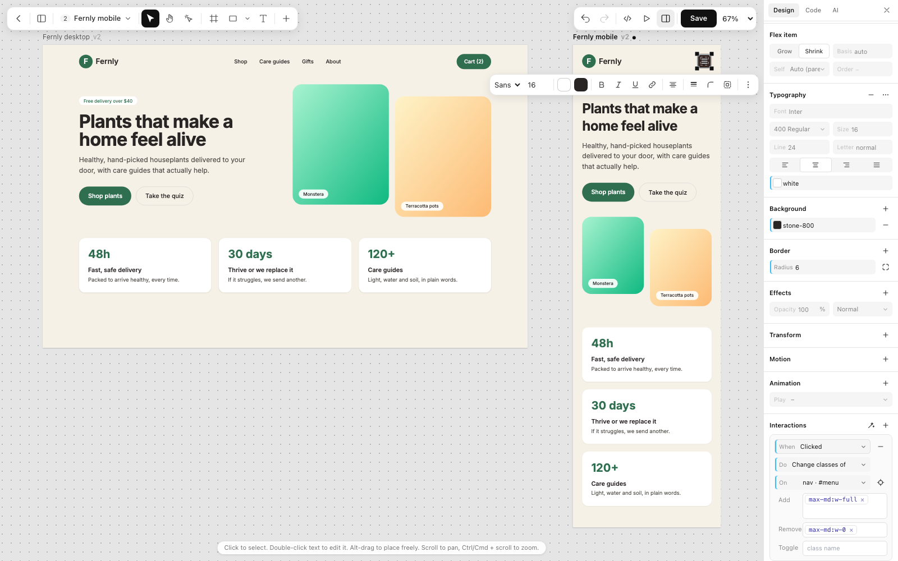
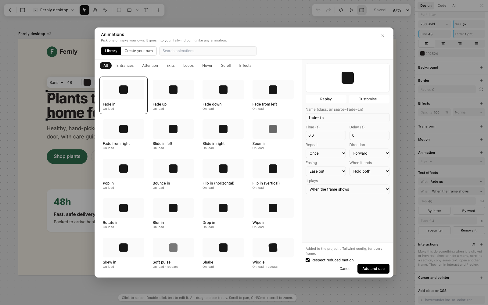
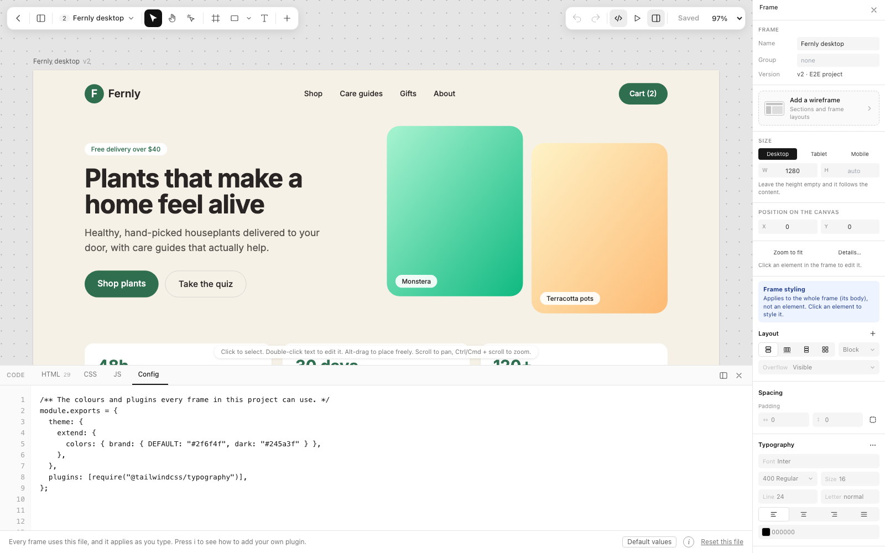

<div align="center">


### Design in Tailwind. Keep it as code.

**A visual design editor where every click writes real Tailwind HTML.**

[](https://www.npmjs.com/package/windcraft-editor)
[](https://nodejs.org)
[](https://tailwindcss.com)
[](#mcp-claude-claude-code-cursor)
[](https://www.figma.com/community/plugin/1697363010304569719)
[](LICENSE)

[**Try it live**](https://windcraft.swapniljadhav.com/) · [Watch the demo](docs/media/windcraft-demo.mp4) · [Get started](#get-started) · [Wiki](https://github.com/Tolaj/windcraft/wiki) · [npm](#npm-windcraft-editor) · [MCP](#mcp-claude-claude-code-cursor) · [Contribute](#contributing)

<br>

[](docs/media/windcraft-demo.mp4)

</div>

## Contents

[What it is](#what-it-is) · [Documentation](#documentation) · [Screenshots](#screenshots) · [What you can do](#what-you-can-do) · [Get started](#get-started) · [How it is built](#how-it-is-built) · [Status](#status) · [Roadmap](#roadmap) · [Contributing](#contributing) · [License](#license)

## What it is

Windcraft is an editor for web pages where the page is plain HTML with Tailwind classes, and every control reads and writes those classes. Make the padding bigger and `p-4` becomes `p-6`. Pick a colour and `bg-rose-500` changes. Edit the code and the design follows; edit the design and the code follows.

There is no export step and no Windcraft-only format. What you see in the editor is the HTML you ship, so you can paste it into a codebase or hand it to a coding agent as it is.

You can start from a blank page, from a Figma design (with a plugin that runs on your computer), or from a description (with Claude or a local model).

## Documentation

The **[Windcraft wiki](https://github.com/Tolaj/windcraft/wiki)** has the guides:

| Page | What is in it |
|---|---|
| [Getting Started](https://github.com/Tolaj/windcraft/wiki/Getting-Started) | Every way in, and your first five minutes |
| [Using the Editor](https://github.com/Tolaj/windcraft/wiki/Using-the-Editor) | Selecting, dragging, screen sizes, handles, the Properties panel |
| [Embedding the Editor (npm)](https://github.com/Tolaj/windcraft/wiki/Embedding-the-Editor-npm) | `startEditor`, `mountEditor`, `embedEditor` and their options |
| [MCP Server](https://github.com/Tolaj/windcraft/wiki/MCP-Server) | Connect Claude, Claude Code or Cursor, what to ask, the tool list |
| [Figma Plugin](https://github.com/Tolaj/windcraft/wiki/Figma-Plugin) | Install, what it converts, what it does not |
| [Self-Hosting](https://github.com/Tolaj/windcraft/wiki/Self-Hosting) | Run the full app, environment variables |
| [Architecture](https://github.com/Tolaj/windcraft/wiki/Architecture) | Packages, the sandboxed frame, how a drag works |
| [Contributing and Reviews](https://github.com/Tolaj/windcraft/wiki/Contributing-and-Reviews) | How to contribute and how pull requests are reviewed |
| [FAQ and Troubleshooting](https://github.com/Tolaj/windcraft/wiki/FAQ-and-Troubleshooting) | Common problems |
| [Roadmap and Status](https://github.com/Tolaj/windcraft/wiki/Roadmap-and-Status) | What is solid, what is new, where to help |

## Screenshots

<p align="center">
  
  <br><sub><b>Select anything.</b> The Properties panel shows its Tailwind classes, and the code panel highlights the exact element.</sub>
</p>

<table>
  <tr>
    <td valign="top" width="50%">
      
      <br><b>Interactions, no JavaScript.</b> Click a button, change classes on the menu. One-click Tabs and Modal.
    </td>
    <td valign="top" width="50%">
      
      <br><b>Animations.</b> A preset library, a keyframe editor, scroll effects. The keyframes go into your Tailwind config.
    </td>
  </tr>
  <tr>
    <td valign="top" width="50%">
      
      <br><b>Your Tailwind config.</b> Edit <code>tailwind.config.js</code> (Tailwind 3) or <code>global.css</code> (Tailwind 4) with plugins. It applies as you type.
    </td>
    <td valign="top" width="50%">
      
      <br><b>Frames and breakpoints.</b> Desktop and mobile side by side. Edits land in the right breakpoint (<code>md:p-8</code>).
    </td>
  </tr>
</table>

## What you can do

- **Edit visually.** Select, move, resize, align, group, copy and paste. Draw frames, shapes, text, images and buttons. Drag to rearrange. Edits are written for the device you are editing (Mobile plain, Tablet `md:`, Desktop `lg:`).
- **Work with the code.** A Properties panel where every field is a Tailwind class, edited at its source, with breakpoints and states. A code panel with HTML, CSS, JS and Config tabs. Paste HTML from anywhere.
- **Make it respond.** Interactions (click or hover to show, hide, change classes, scroll, copy, go to another frame), one-click Tabs and Modal, animations, scroll-linked effects, text effects, SVG drawing.
- **Bring things in.** A free Figma plugin (no LLM, no network). Or describe a page and let Claude or a local model draft it.
- **Connect and share.** An MCP server for Claude, Claude Code and Cursor. Projects with their own look, share links, a full-screen prototype, export to HTML, React, Vue or Svelte, version history.

## Get started

| I want to... | Use |
|---|---|
| Try it now | [The live editor](#online) |
| Put the editor in my own site or app | [npm: `windcraft-editor`](#npm-windcraft-editor) |
| Let Claude, Claude Code or Cursor build pages | [The MCP server](#mcp-claude-claude-code-cursor) |
| Turn a Figma design into Tailwind | [The Figma plugin](#figma-plugin) |
| Run my own copy | [Self-host](#self-host-the-full-app) |
| Hack on the editor | [Run it locally, no database](#run-the-editor-locally-no-database) |

### Online

Open **<https://windcraft.swapniljadhav.com/>**. Nothing to install.

### npm: `windcraft-editor`

```bash
npm install windcraft-editor
```

Serve `node_modules/windcraft-editor` as static files and import from it. No bundler or backend is needed.

```js
import { startEditor } from "/windcraft/editor/index.js";
startEditor(document.getElementById("root"), { html: "<h1>Hello</h1>" });
```

| Function | Use it when |
|---|---|
| `startEditor(root, options)` | The editor is the whole page. Designs are saved in the browser. |
| `mountEditor(root, options)` | You load and save on your own server (give it a few host functions). |
| `embedEditor(root, options)` | The editor lives in one box of a page, in an iframe. |

Options, host functions and `onChange` are in the [full guide](packages/editor/README.md).

### MCP: Claude, Claude Code, Cursor

Windcraft runs an [MCP](https://modelcontextprotocol.io) server at your address plus `/mcp` (for the live site: `https://windcraft.swapniljadhav.com/mcp`).

| Client | How to connect |
|---|---|
| **Claude** (claude.ai) | Settings → Connectors → Add custom connector → paste the address → sign in to Windcraft → Allow. |
| **Claude Code** | Create a token on the Connect page (`/connect`), then `claude mcp add --transport http tailwind-library <address> --header "Authorization: Bearer <token>"` |
| **Cursor** and others | Add an HTTP server with the address and the header `Authorization: Bearer <token>`. |

Then ask: *"Read my design guide, then build a settings page that matches"*, *"Search my library for a pricing table and use it"*, or *"Save this page to my Windcraft library."* The [MCP guide](https://github.com/Tolaj/windcraft/wiki/MCP-Server) has the tool list.

### Figma plugin

Install it from the [Figma Community](https://www.figma.com/community/plugin/1697363010304569719). It converts a selection to HTML and Tailwind on your computer, with no LLM and no network. To build it from source, see [packages/figma](packages/figma/README.md).

### Self-host the full app

Accounts, projects, the gallery, AI and MCP. You need Node.js 18+ and MongoDB (local or Atlas).

```bash
git clone https://github.com/Tolaj/windcraft.git
cd windcraft
npm install
cp .env.example .env     # fill in MONGO_URI and SESSION_SECRET at least
npm run dev              # http://localhost:3000
```

`MONGO_URI` and `SESSION_SECRET` are required. `ANTHROPIC_API_KEY` or `LLM_URL` turns on AI, and `PUBLIC_URL` lets Claude on the web reach your MCP server. `.env.example` lists the rest. For production use `npm start`; a `vercel.json` is included.

### Run the editor locally (no database)

```bash
git clone https://github.com/Tolaj/windcraft.git
cd windcraft
npm install
npm run demo             # http://localhost:4000/editor/demo/
```

## How it is built

A monorepo of small packages around a Node app.

| Package | What it does |
|---|---|
| [`windcraft-editor`](packages/editor) | The visual editor (on npm). Host-agnostic. |
| [`@windcraft/core`](packages/core) | The Tailwind logic as pure functions with tests. |
| [`@windcraft/figma`](packages/figma) | The Figma to Tailwind converter and plugin. Fixed rules, no LLM. |
| [`@windcraft/mcp`](packages/mcp) | The MCP protocol for Express. |
| [`@windcraft/ai`](packages/ai) | Provider-neutral AI generation (Anthropic and OpenAI-compatible). |
| `src/` | The app: Express 5, Handlebars, MongoDB. |

**Stack:** Node.js · Express 5 · Handlebars · MongoDB · Tailwind CSS · CodeMirror 6 · Anthropic SDK.

`npm test` runs the unit tests, `npm run e2e` the browser tests (they need MongoDB and Chrome), `npm run typecheck` the types. [CONTRIBUTING.md](CONTRIBUTING.md) has the repo map.

## Status

Windcraft is under active development.

- **Solid:** the Properties panel, the code panel, selection and layers, the Figma converter's basic rules, projects and sharing.
- **Newer:** Interactions, animations, the Tailwind config tab, and dragging to rearrange. They are tried in Chrome only. Safari, Firefox and touch are untried ([#8](https://github.com/Tolaj/windcraft/issues/8)), and big pages have not been timed ([#9](https://github.com/Tolaj/windcraft/issues/9)).
- **Known gaps:** see the [open bugs](https://github.com/Tolaj/windcraft/labels/bug).

## Roadmap

- Figma converter: constraints, lists, image crop, and responsive output.
- Components and variants as first-class Windcraft components.
- A steadier drag in more browsers and on large pages.

## Contributing

Windcraft is MIT licensed and open to everyone. You do not need to ask first.

1. **Fork** the repo, `npm install`, and `npm run demo` to see your change.
2. **Branch** and keep the pull request small and about one thing.
3. **Check** with `npm test` and `npm run typecheck`. A bug fix in `packages/core` or the Figma converter should come with a test that fails without it.
4. **Open a pull request** into `main` and say what you changed and how you checked it.

Good places to start: [`good first issue`](https://github.com/Tolaj/windcraft/labels/good%20first%20issue) and [`help wanted`](https://github.com/Tolaj/windcraft/labels/help%20wanted). [CONTRIBUTING.md](CONTRIBUTING.md) and the wiki's [Contributing and Reviews](https://github.com/Tolaj/windcraft/wiki/Contributing-and-Reviews) explain how reviews work. For questions, bugs and ideas, [open an issue](https://github.com/Tolaj/windcraft/issues/new) with the steps, what you expected, what happened and your browser.

## License

[MIT](LICENSE) © 2026 Swapnil Jadhav. Third-party code keeps its own licenses: [THIRD_PARTY_LICENSES.md](THIRD_PARTY_LICENSES.md).

<div align="center">
<br>
<sub>Built by <a href="https://github.com/Tolaj">Swapnil Jadhav</a>.</sub>
</div>
