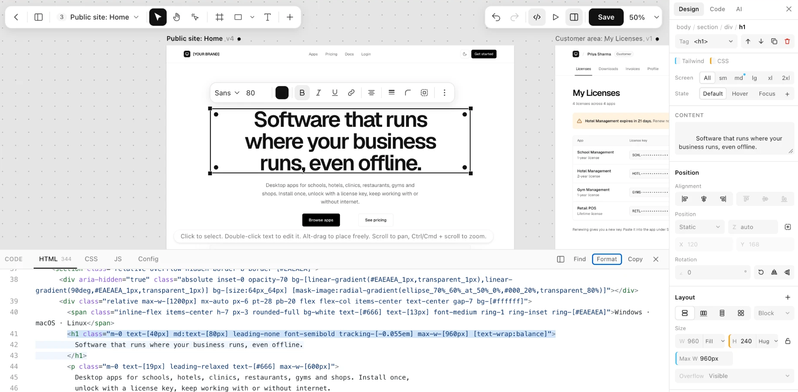

<p align="center">
  <a href="https://github.com/Tolaj/windcraft"></a>
</p>

# windcraft-editor

A visual editor for **HTML + Tailwind** that you can put in any web page. Select, drag and style like Figma, and every change is real Tailwind code. No backend and no build step needed.

[Live demo](https://windcraft.swapniljadhav.com/editor/demo/index.html) · [Full documentation](https://github.com/Tolaj/windcraft/blob/main/docs/editor/README.md) · [Issues](https://github.com/Tolaj/windcraft/issues)



## Pick your way in

| I want to... | Use | Jump to |
|---|---|---|
| Try it in two minutes, no install | `startEditor` from a CDN | [One file](#1-one-file-no-install) |
| Add it to my own site or app | `startEditor` / `mountEditor` + npm | [npm](#2-install-from-npm) |
| Use it in React, Vue, Next, Vite... | The same, loaded as static files | [Frameworks](#3-react-vue-next-vite-and-other-frameworks) |
| Save designs on my server | `mountEditor` with a host | [Save to your server](#4-save-to-your-own-server) |
| Put it in one box of a page (a CMS field, a form, a template editor) | `embedEditor` | [Inside a box](#5-inside-one-box-of-a-page) |
| Read or change the HTML from my own code | the editor object | [Read and write the HTML](#6-read-and-write-the-html-from-your-code) |

## 1. One file, no install

Save this as `index.html`, run `npx serve` next to it, and open the address it prints.

```html
<div id="root"></div>
<script type="module">
  import { startEditor } from "https://cdn.jsdelivr.net/npm/windcraft-editor/editor/index.js";
  startEditor(document.getElementById("root"), {
    html: '<h1 class="p-10 text-4xl font-bold">Hello</h1>',
  });
</script>
```

`https://unpkg.com/windcraft-editor/editor/index.js` works the same. Designs are saved in the browser (localStorage).
Pin a version in real pages: `windcraft-editor@0.3.1`.

## 2. Install from npm

```bash
npm install windcraft-editor
```

The editor is plain ES modules, so the package folder only has to be **served as static files**. With Express:

```js
import express from "express";
const app = express();
app.use("/windcraft", express.static("node_modules/windcraft-editor"));
app.use(express.static("public"));
app.listen(3000);
```

```html
<div id="root"></div>
<script type="module">
  import { startEditor } from "/windcraft/editor/index.js";
  startEditor(document.getElementById("root"), {
    html: "<h1>Hello</h1>",
    title: "Landing page",                    // the design's name
    key: "my-site-editor",                    // localStorage key; use different ones for different editors
    theme: { brand: "#e11d48", gray: "stone", font: "Poppins", radius: "xl" },
  });
</script>
```

Any static host does the job (nginx, Caddy, S3, Netlify, GitHub Pages): copy `node_modules/windcraft-editor` somewhere public and import from there.

## 3. React, Vue, Next, Vite and other frameworks

Do not feed the package to your bundler. Put the folder in your **public / static directory** and load it by URL from the browser, in an effect that runs on the client.

```bash
# copy once (or add it to your build script)
cp -r node_modules/windcraft-editor public/windcraft
```

**React / Next.js**

```jsx
import { useEffect, useRef } from "react";

export default function Editor({ html }) {
  const ref = useRef(null);
  useEffect(() => {
    let alive = true;
    import(/* webpackIgnore: true */ /* @vite-ignore */ "/windcraft/editor/index.js").then(({ startEditor }) => {
      if (alive) startEditor(ref.current, { html });
    });
    return () => { alive = false; };
  }, []);
  return <div ref={ref} style={{ height: "100vh" }} />;
}
```

**Vue**

```vue
<template><div ref="root" style="height: 100vh" /></template>
<script setup>
import { ref, onMounted } from "vue";
const root = ref(null);
onMounted(async () => {
  const { startEditor } = await import(/* @vite-ignore */ "/windcraft/editor/index.js");
  startEditor(root.value, { html: "<h1>Hello</h1>" });
});
</script>
```

Only one full-page editor (`startEditor` / `mountEditor`) can run per page. To show several, or to put one in a part of a layout, use [`embedEditor`](#5-inside-one-box-of-a-page).

## 4. Save to your own server

`startEditor` keeps designs in the browser. To load and save on your server, use `mountEditor` and give it a **host**: a handful of functions the editor calls.

```js
import { mountEditor } from "/windcraft/editor/index.js";

const json = (r) => r.json();
const send = (method, url, body) =>
  fetch(url, { method, headers: { "Content-Type": "application/json" }, body: JSON.stringify(body) }).then(json);

const host = {
  createComponent: (fields) => send("POST", "/api/designs", fields),          // resolve to the saved record: { _id, version, ... }
  updateComponent: (id, fields) => send("PUT", `/api/designs/${id}`, fields),
  deleteComponent: (id) => send("DELETE", `/api/designs/${id}`),              // optional: leave it out and there is no Delete
  createProject: async (name) => ({ id: "main", name }),
  saveLayout: async () => {}, saveLayoutOnExit: () => {},
  showDesign: (id) => history.replaceState({}, "", id ? `?design=${id}` : location.pathname),
  openDesign: (id) => { location.href = `?design=${id}`; },
};

const saved = await fetch("/api/designs/42").then(json);   // the design to open
await mountEditor(document.getElementById("root"), {
  host,
  data: { id: saved._id, title: saved.title, htmlCode: saved.htmlCode, version: saved.version },
});
```

The required functions are `createComponent`, `updateComponent`, `createProject`, `saveLayout`, `saveLayoutOnExit`, `showDesign` and `openDesign`. A function that does nothing is fine when you have no use for it. The optional ones switch parts of the editor on (an AI box, a Delete button, a preview page, a gallery of designs to add).
[`editor/local-host.js`](https://github.com/Tolaj/windcraft/blob/main/packages/editor/local-host.js) is a complete host to copy, and the [host reference](https://github.com/Tolaj/windcraft/blob/main/docs/editor/host.md) lists every function with a matching Express backend.

## 5. Inside one box of a page

`embedEditor` puts the editor in an iframe inside any element, so it has its own keys, zoom and styles and several can share a page.

```js
import { embedEditor } from "/windcraft/editor/index.js";

const ed = embedEditor(document.getElementById("box"), {
  host,                                         // as above (a no-op host is enough if you save the HTML yourself)
  data: { htmlCode: "<h1 class='p-8'>Hello</h1>" },
  ui: { panels: false, nav: false },            // hide the side panels and the top navigation
});

ed.onChange(({ html }) => { document.getElementById("field").value = html; });  // keep a form field in step
```

| `ui` option | Effect |
|---|---|
| `panels: false` | no Layers, Properties or Code panels |
| `nav: false` | no Back, page list or project |
| `tools: ["move","hand","text"]` | only these tools (`move hand interact frame shape text add`); `null` keeps all |

## 6. Read and write the HTML from your code

`mountEditor` resolves to this object. `embedEditor` returns the same methods straight away, plus `ed.ready`, a promise that resolves once the editor has painted the design.

```js
const ed = await mountEditor(root, { host, data });

ed.getHtml();                         // the HTML as it is now
ed.setHtml("<p class='p-4'>New</p>"); // replace it (one undo step)
ed.onChange(({ html, dirty, source }) => {}); // source: "editor" | "host" | "status"
ed.isDirty();                         // unsaved changes?
ed.save();                            // the editor's own save
```

## Options at a glance

| Option | On | What it does |
|---|---|---|
| `html`, `title`, `key`, `theme` | `startEditor` | start HTML, design name, localStorage key, `{ brand, gray, font, radius }` |
| `host` | `mountEditor`, `embedEditor` | your load and save functions |
| `data` | `mountEditor`, `embedEditor` | the design to open: `{ id, title, htmlCode, version, ... }` |
| `ui` | `mountEditor`, `embedEditor` | `panels`, `nav`, `tools`, `onDetails` |
| `back` | `mountEditor` | `{ href, label }` for a Back link |
| `tailwind: false` | all | your page already loads Tailwind's play CDN |
| `src` | `embedEditor` | where the editor's `embed.html` is served, if not next to `index.js` |

`theme`: `gray` is one of `slate gray zinc neutral stone`, `radius` one of `none sm md lg xl`, `brand` any hex colour and `font` any Google font name.

## Good to know

- The editor loads Tailwind's play CDN (v3) unless you pass `tailwind: false` because your page already has it.
- It needs a browser (it uses the DOM), so render it on the client only in SSR frameworks.
- One full-page editor per page. It takes over the page's size and keyboard; use `embedEditor` for anything smaller.
- Designs from `startEditor` live in localStorage, so they belong to one browser. Use `mountEditor` with a host to keep them on your server.

## Documentation

- [Getting started](https://github.com/Tolaj/windcraft/blob/main/docs/editor/getting-started.md): every way to load the editor, step by step
- [API reference](https://github.com/Tolaj/windcraft/blob/main/docs/editor/api.md): `startEditor`, `mountEditor`, `embedEditor` and the editor object
- [Host reference](https://github.com/Tolaj/windcraft/blob/main/docs/editor/host.md): saving, projects, AI and the rest, with an Express backend
- [Recipes](https://github.com/Tolaj/windcraft/blob/main/docs/editor/recipes.md): a CMS field, an email template editor, AI, a themed editor
- [Troubleshooting](https://github.com/Tolaj/windcraft/blob/main/docs/editor/troubleshooting.md)

Source, demo and issues: https://github.com/Tolaj/windcraft. MIT licensed.
